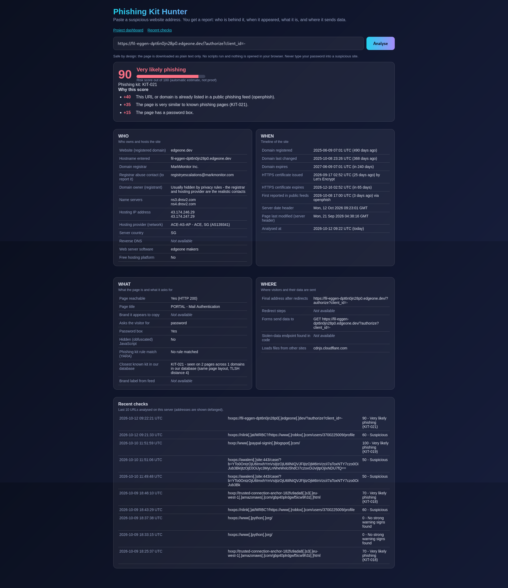
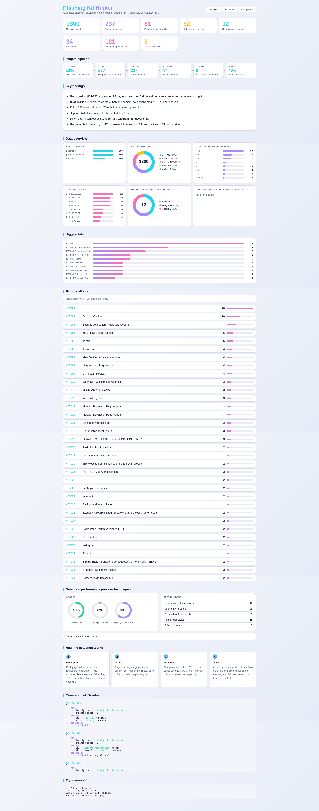

# Phishing Kit Hunter

A student research project that finds phishing kits instead of single phishing URLs.

It collects phishing URLs from public feeds, downloads the pages safely, groups pages that
come from the same kit, writes detection rules for each kit, and has a live web page where
anyone can paste a suspicious URL and get a report on who is behind it, when it appeared,
what it is, and where it sends stolen data.

A simple explanation of the whole project is in Phishing_Kit_Hunter_Explanation.pdf in this repository.

Author: Vanshika Deep

Note: this repository contains documentation only. The full source code is not published here.
This guide explains the ideas, the design and every step, so you can build your own version.

---

## 1. The problem

Phishing means a fake website that tricks people into typing passwords or other private data.

Criminals do not build every fake page from scratch. They use a ready-made package called a
phishing kit: HTML pages, images, scripts, and usually a small script that sends the stolen
data to the criminal (for example to a Telegram bot).

One kit is reused again and again. The same kit can appear on hundreds of different URLs.
The URLs look different, but the pages underneath are almost the same.

Blocking one URL after it is reported does not stop the attack, because the criminal uploads the
same kit to a new URL. If we can recognise the kit itself, we can catch new copies too.

## 2. What this project does

1. Collects phishing URLs from public feeds and stores them in a database.
2. Downloads the page of each URL safely (text only, no scripts are run).
3. Measures about 20 features of each page (layout, form fields, file names, hidden code, where data is sent).
4. Groups similar pages. Each group is one phishing kit.
5. Writes a YARA detection rule for each kit automatically.
6. Tests the rules on pages they have never seen and on normal websites.
7. Shows results in statistics, a chart and an HTML dashboard.
8. Live analyzer: a web page where a user pastes any URL and gets a who / when / what / where report with a risk score.

## 3. How it works

```
 Public feeds (OpenPhish, PhishTank, Phishing.Database)
            |
            v
 1. COLLECT  - save URLs in a SQLite database
            |
            v
 2. FETCH    - download each page safely
            |
            v
 3. EXTRACT  - measure features of each page
            |
            v
 4. CLUSTER  - group similar pages (one group = one kit)
            |
            v
 5. RULES    - generate a YARA rule for each kit
            |
            v
 6. TEST     - unseen phishing pages + normal websites
            |
            v
 7. REPORT   - statistics, chart, dashboard

 Live analyzer: paste a URL -> who / when / what / where report + risk score
```

## 4. The live URL analyzer

The user pastes a URL and presses Analyse. The server runs fresh lookups at that moment and
shows a report with five parts.

Risk score (0 to 100) with a plain-English list of reasons, for example "matches the rule of a known kit"
or "domain registered only a few days ago". It is an automatic estimate, not proof.

WHO - who owns and hosts the site
- registered domain, domain registrar, registrar abuse contact (useful for reporting the site)
- name servers, hosting IP address, hosting provider and network, server country
- whether it is on a free hosting platform

WHEN - timeline
- domain registration date, last change and expiry
- HTTPS certificate issue and expiry dates
- when the URL was first reported in public feeds (if it is in the database)
- server date headers

WHAT - what the page is
- page title, the brand it seems to copy, and what it asks for (password, one-time code, card details)
- whether it has hidden (obfuscated) JavaScript
- whether a kit rule matches, and the closest known kit in the database

WHERE - where data goes
- final address after redirects and the redirect steps
- where the forms send data, and any Telegram, Discord or Formspree endpoint found in the code

Simple API (the web page uses the same endpoints):

| Endpoint | What it does |
|---|---|
| POST /api/analyze with {"url": "..."} | Returns the full report as JSON |
| GET /api/analyze?url=... | Same, for quick tests |
| GET /api/recent | The last 10 checks (addresses are defanged) |
| GET /health | Returns ok (used by hosting platforms) |
| GET /dashboard | The project dashboard |

How the risk score works: each warning sign adds points (for example a matching kit rule, a password
box, hidden JavaScript, a Telegram endpoint, a very new domain, a free hosting platform, an untrusted
certificate). Signs of a genuine site subtract points (for example an official domain of a known brand,
or a domain older than five years). The result is limited to 0 to 100.

## 5. Tools and libraries

| Tool | Used for |
|---|---|
| Kali Linux in VirtualBox | Safe, separate machine for the work |
| Python 3 and venv | Main language and a private library folder |
| requests | Downloading feeds and pages |
| BeautifulSoup4 and lxml | Reading HTML |
| tldextract | Splitting URLs into domain and ending |
| python-tlsh | Page similarity hash |
| yara-python | Compiling and running YARA rules |
| SQLite | The database (one file) |
| matplotlib | The chart |
| Flask and gunicorn | The live analyzer web app |
| ipwhois and RDAP | Hosting owner and domain registration lookups |
| Docker | Packaging for deployment |
| Git and GitHub | Version control and sharing |

## 6. Project layout (names only)

```
phish-kit-hunter/
  src/        the Python scripts (one per stage, plus the web app)
  rules/      generated YARA rules
  db/         SQLite database
  data/       raw feeds, downloaded pages, normal pages (never published)
  reports/    statistics, chart, dashboard
  logs/       reserved for logs
```

| Script | Job |
|---|---|
| config / db | Shared settings and database tables |
| collect | Stage 1: download the feeds |
| fetch | Stage 2: download the pages |
| extract | Stage 3: measure the features |
| cluster | Stage 4: group pages into kits |
| rules | Stage 5: write YARA rules |
| benign_fetch | Download normal websites for testing |
| evaluate | Stage 6: detection rate and false positives |
| detect | Check one URL against the rules from the terminal |
| report / dashboard | Stage 7: statistics, chart and dashboard |
| analyze_url / webapp | The live analyzer and its website |

Database tables: urls, pages, features, clusters, benign, hosts, lookups.

## 7. Build it yourself, step by step

### Step 0: Setup

1. Install VirtualBox and a Kali Linux virtual machine. Take a snapshot before starting.
2. Install system tools: python3-pip, python3-venv, python3-dev, build-essential, cmake, libssl-dev, libmagic-dev, git, sqlite3, curl.
3. Create a project folder with the subfolders shown above.
4. Create a virtual environment and activate it:

```
python3 -m venv venv
source venv/bin/activate
```

5. Install the libraries: requests, beautifulsoup4, lxml, tldextract, python-tlsh, yara-python, matplotlib, flask, gunicorn, ipwhois.
6. Test the feed with curl and make your first git commit.

### Step 1: Collect URLs

- OpenPhish: a plain text list, one URL per line.
- PhishTank: a CSV (compressed) with the URL, the target brand and the submission time. Check their developer page for current rules and use their recommended User-Agent.
- Phishing.Database (GitHub): a list of active phishing links.

Tips: save a dated copy of every raw download, clean each URL, store the registered domain, and make the URL column unique so running it daily never creates duplicates.

### Step 2: Fetch the pages

- Download several pages in parallel (about 10 workers).
- Use a normal browser User-Agent, a short timeout (about 12 seconds) and a size limit (about 2 MB).
- Follow redirects and keep the redirect chain. Do not stop for bad certificates, because many phishing sites have them.
- Mark each URL as fetched, dead, failed or not HTML. Expect most to be dead. Phishing sites are taken down quickly.
- Save the HTML under the SHA-256 hash of its content, so identical pages are stored once.
- Store the IP address and server headers.
- Check if the web folder is an open directory. If it lists .zip or .rar files, that may be the kit itself.

### Step 3: Extract features

Turn every page into a small fingerprint:

- page title and number of HTML tags (very small pages are ignored later)
- form actions and input field names, and whether there is a password box
- local file names (scripts, styles, images), and other sites the page loads files from
- signs of hidden code (eval, atob, unescape, fromCharCode, hex codes)
- where stolen data is sent: a Telegram bot ID, a Discord webhook, a Formspree form, or a form that posts to another site
- a hash of the order of the HTML tags (layout hash) and a hash of the local file list
- a TLSH similarity hash of the whole page
- URL facts: length, dots, hyphens, ending, file name

### Step 4: Cluster into kits

Link two pages if any of these is true:

- same layout hash
- same file-list hash
- same data-stealing endpoint
- TLSH distance below a threshold (a good starting value is 70)

Pages that are linked directly or through other pages form one group (this is the union-find method).
Name the groups KIT-001, KIT-002 and so on, biggest first. Pages that match nothing stay single.
Lower the TLSH threshold for stricter groups and raise it for looser groups.

Why TLSH: a normal hash such as MD5 changes completely if one character changes. TLSH gives a small
distance for pages that are almost the same, so it finds slightly modified copies of a kit.

### Step 5: Generate YARA rules

- Use only about 70 percent of the pages to build rules. Keep 30 percent hidden for fair testing.
- Only make a rule for kits with at least 3 training pages.
- Find things that appear in at least 80 percent of a kit's pages: file names, page title, data-stealing endpoint, form field names.
- Ignore common library files (jQuery, Bootstrap, analytics and so on) because normal sites use them too.
- Treat file names, title and endpoint as distinctive strings, and form field names as a second check.
- Rule condition: at least 60 percent of the distinctive strings AND at least one of the form field names.
- Compile the rules with YARA to check that they are valid.

### Step 6: Test the rules

- Scan the hidden 30 percent of pages and count how many are detected, and how many are detected as the correct kit.
- Download login and home pages of well-known websites and scan them. Every match here is a false positive.
- Report the detection rate and the number of false positives. Both numbers matter. A rule that flags everything would catch 100 percent but is useless.

### Step 7: Report and dashboard

- Count everything in the database (sources, fetch results, password pages, hidden code, endpoints, top endings, top hosting IPs, kits).
- Draw a bar chart of pages per kit.
- Build one HTML page with summary cards, charts, a searchable list of kits (show URLs defanged, for example hxxp and [.]), the test results and the rules.

### Step 8: Build the live analyzer

- Write one function that takes a URL and returns the report. Run the slow lookups at the same time (page download, domain registration, hosting owner, certificate).
- Domain registration comes from the public RDAP system (the modern WHOIS). Hosting owner comes from IP lookups. Certificate dates come from a normal TLS connection.
- Compare the page with the database using the same layout hash, endpoint and TLSH distance to name the closest known kit.
- Build the risk score from simple, explainable rules and always show the reasons.
- Wrap the function in a small Flask web app with one page, a JSON endpoint, a health endpoint and a rate limit.
- When you put text from a downloaded page on the web page, always insert it as plain text, because the page is controlled by the attacker.

## 8. How detection works

Think of a kit as a person and the rule as a description: red cap, blue bag, limp. You do not need the
face. If most details match, it is probably the same person.

A rule lists strings that most pages of the kit share, and a condition. This is only an example of the format:

```
rule KIT_EXAMPLE
{
    strings:
        $d1 = "login-style.css" nocase
        $d2 = "verify.js" nocase
        $d3 = "api.telegram.org/bot123456" nocase
        $i1 = /name=["']passwd["']/ nocase
    condition:
        2 of ($d*) and any of ($i*)
}
```

A new page matches if enough of the distinctive strings are present and one of the form fields is found.
Because the rule is built from what most pages of the kit share, a new copy of the same kit will match even if
its URL, domain and hosting are all different.

The threshold is a balance. A lower threshold catches more modified kits but may flag normal pages. A higher
threshold is stricter but may miss changed kits.

## 9. Results from my run

These numbers come from one run and will be different when you run it on a different day.

| Item | Value |
|---|---|
| URLs collected | 1300 (OpenPhish 300, PhishTank 500, Phishing.Database 500) |
| Pages downloaded live | 237 |
| Pages with a password field | 81 |
| Pages with hidden JavaScript | 52 |
| Pages with a data-stealing endpoint | 12 |
| Open directories found | 0 |
| Pages used for clustering | 200 |
| Kits found | 34 |
| Pages that belong to a kit | 121 of 200 |
| Detection rate on unseen kit pages | 43.2 percent |
| False positives on normal websites | 0 out of 21 |

Screenshots:




## 10. Safety and ethics

- Work only inside a virtual machine, never on your main computer.
- Never open the phishing URLs in a browser. Download them as text with a script that does not run JavaScript.
- Never type any data into a phishing page.
- Use only public feeds and follow each feed's terms of use and rate limits.
- Never publish downloaded phishing pages, tokens or passwords. Keep the data folder out of git.
- If you build a public analyzer, protect your server: refuse internal addresses (localhost, private networks, cloud metadata addresses), check every redirect step, allow only normal web ports, limit page size and time, and rate-limit visitors.
- Show URLs defanged (hxxp and [.]) so nobody clicks them by mistake.
- This project is for research and defence only.

## 11. Limitations

- Phishing sites die quickly, so the sample is small (237 live pages from 1300 URLs).
- Pages are downloaded as plain HTML. Pages that build their content with JavaScript may look empty.
- No open directories were found, so no real kit ZIP file was studied.
- Attackers can change file names or text, and then a rule may stop matching.
- Only 21 normal websites were used for the false positive test, and many of them load content with JavaScript. A larger test set would be better.
- Domain owner (registrant) details are usually hidden, so the registrar and hosting provider are the realistic contacts.
- Some domain endings do not offer registration data through RDAP.
- The risk score is a simple rule-based estimate, not a verdict.
- A determined attacker could still try to trick the address checks of a public analyzer, so do not treat the protection as perfect.

## 12. Future work

- Run the pipeline every day (cron) and track how kits grow.
- Store hosting owner and country for every page.
- Compare screenshots to find kits that look the same but have different code.
- Test with a much larger set of normal websites.
- Draw a network graph of kits, domains and IPs.
- Add machine learning for the risk score.
- Share the rules with a blocklist or security tool.

## 13. Put your own project on GitHub (first time)

1. Install git: `sudo apt install git`. Set your name and email once:

```
git config --global user.name "Your Name"
git config --global user.email "you@example.com"
```

2. Create an account at github.com and verify your email.
3. Click the + at the top right, then New repository. Choose a name. Choose Public or Private. Leave "Add a README", ".gitignore" and "license" unticked, then click Create repository.
4. Create a token, because GitHub does not accept your account password for uploads: Settings, Developer settings, Personal access tokens, Tokens (classic), Generate new token (classic), tick the repo box, generate, and copy it immediately (it is shown only once). Keep it secret and never put it in a file or a chat.
5. Make a clean folder that contains only what you want online. Do not include venv, the data folder or any downloaded phishing pages. A .gitignore file helps.
6. In that folder run these, replacing YOUR_USERNAME and YOUR_REPO:

```
git init
git add .
git commit -m "First version"
git branch -M main
git remote add origin https://github.com/YOUR_USERNAME/YOUR_REPO.git
git push -u origin main
```

When asked, type your GitHub username, then paste the token as the password (nothing appears while you paste).

7. Refresh the repository page on GitHub to check that your files are there.

To update later: change files, then `git add .`, `git commit -m "what changed"`, `git push`.

Common errors:

| Message | Fix |
|---|---|
| Author identity unknown | Run the two git config commands above, then commit again |
| remote origin already exists | `git remote remove origin`, then add it again |
| Authentication failed | Use the token as the password, not your account password |
| Repository not found | Check the name with `git remote -v` and fix it with `git remote set-url origin URL` |
| Updates were rejected | The repository was not empty. If it is your new repository, `git push -u origin main --force` |

## 14. Deploy it online (Render example)

A web app that downloads pages is best deployed as a container. You need a Dockerfile that starts from a
slim Python image, installs the build tools needed by the YARA and TLSH libraries, installs the Python
requirements, copies the app, and starts it with gunicorn on the port given by the platform in the PORT
variable. Keep the container to one worker with a few threads.

Steps:

1. Put the app (with its Dockerfile and requirements file) in a GitHub repository.
2. Create a free account at render.com.
3. Click New, then Web Service, and connect your GitHub repository.
4. Choose the Docker runtime and the Free instance type.
5. Set the health check path to /health.
6. Click Create Web Service and wait for the build (several minutes, because some libraries compile).
7. Open the public link and test it.

At the time of writing, Render's free web services go to sleep after 15 minutes without traffic and take about a
minute to wake up, and files written while the app runs are lost when it restarts. Check Render's documentation for
the current limits.

## 15. Data sources and credits

- OpenPhish: https://openphish.com
- PhishTank: https://phishtank.org
- Phishing.Database: https://github.com/mitchellkrogza/Phishing.Database
- TLSH: https://github.com/trendmicro/tlsh
- YARA: https://virustotal.github.io/yara/

Please read each source's terms of use before you use its data.

## 16. Disclaimer

This is an educational project. Results are automatic estimates and can be wrong. Do not use them as the only
basis for blocking, accusing or reporting anyone. Use the information only for defence.
